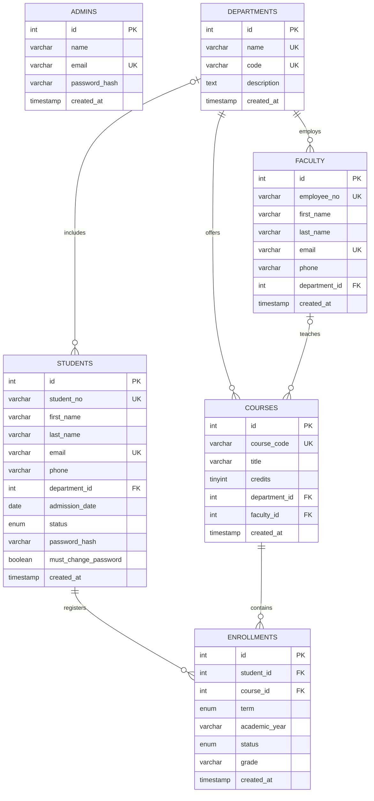

# University Management System

## 1. Cover Page

**Database Management Systems course project**  
**Chandigarh University**  
**Department of Computer Science and Engineering**

| Team member | UID |
|---|---|
| Apurva Anand | 25BCS12080 |
| Tabish Khan | 25BCS12094 |

This project is a PHP and MySQL application for managing university departments, faculty, students, courses and enrollments. It includes a separate administrator workspace and student portal.

## 2. Abstract

The University Management System stores academic records in a MySQL relational database and provides separate interfaces for administrators and students. Administrators maintain department, faculty, student, course and enrollment records. They can provision student accounts with temporary passwords; students must set a new password at their first sign-in. Students can review their profiles, browse courses, enroll for a term and view their own grades.

The database contains six InnoDB tables: `admins`, `departments`, `faculty`, `students`, `courses` and `enrollments`. Primary keys, unique constraints, foreign keys and a unique enrollment key help preserve data integrity. The PHP application uses PDO prepared statements, hashed passwords, session authentication, CSRF tokens, input validation and escaped HTML output.

## 3. Introduction

Universities maintain information about students, faculty, departments, courses and registrations. Keeping these records in unrelated lists makes it harder to avoid duplicate data and inconsistent references. A relational database connects these records and enforces rules about which relationships are valid.

This project combines a MySQL database with a server-rendered PHP application. Administrators use the management workspace to maintain campus records. Students sign in separately with their student ID and administrator-issued password to access their own portal.

### Team members

| Name | UID |
|---|---|
| Apurva Anand | 25BCS12080 |
| Tabish Khan | 25BCS12094 |

### Technology stack

| Component | Technology |
|---|---|
| Application | PHP 8+ |
| Database | MySQL 8+, InnoDB, `utf8mb4` |
| Database access | PHP PDO with the PDO MySQL driver |
| Interface | HTML and responsive CSS |
| Local development server | PHP built-in web server |

## 4. Problem Statement and Objectives

### Problem statement

University academic records should be organized, related, and accessible only to authorized users. Records stored without well-defined relationships can become inconsistent, and students should not be able to see another student's private profile or grades.

**Problem statement:** Design and implement a relational university management system that centralizes academic records, enforces database relationships, and lets an authenticated student access only their own profile and enrollment information.

### Objectives

- Design a relational MySQL schema with primary, unique and foreign keys.
- Provide administrator CRUD operations for five academic record types.
- Allow administrators to provision students with hashed temporary passwords.
- Require students to replace temporary passwords at first sign-in.
- Let students view their profile, browse courses, enroll and review their own grades.
- Demonstrate SQL implementation, normalization, joins, subqueries and aggregate functions.

## 5. Scope of the Project

| Module | Scope |
|---|---|
| Administrator | First-admin setup, secure sign-in and protected management workspace |
| Departments | Create, view, update and delete department records |
| Faculty | Manage employee ID, contact details and department |
| Students | Manage student profiles and optionally enable/reset portal access |
| Courses | Manage course code, title, credits, department and optional instructor |
| Enrollments | Manage registrations, term, academic year, status and grade |
| Student portal | Student profile, course catalog, self-enrollment and personal grades |

Fees, attendance, timetables, prerequisites, course capacity, transcripts, email-based password recovery and faculty self-service are not implemented. Student account creation and password resets are administrator-managed.

## 6. Requirement Analysis

### Functional requirements

| ID | Requirement |
|---|---|
| FR-01 | Authenticate administrators using their registered email and password. |
| FR-02 | Allow administrators to manage departments, faculty, students, courses and enrollments. |
| FR-03 | Let administrators provision student accounts with hashed temporary passwords. |
| FR-04 | Require a student to change the temporary password before using the portal. |
| FR-05 | Authenticate students with their student ID and password. |
| FR-06 | Display the authenticated student's profile, course catalog, enrollments and grades. |
| FR-07 | Let students enroll in a course for a selected term and academic year. |
| FR-08 | Prevent duplicate enrollments for the same student, course, term and academic year. |

### Non-functional requirements

| Category | Requirement |
|---|---|
| Security | Password hashing, prepared SQL statements, CSRF tokens, session checks and escaped output |
| Data integrity | InnoDB foreign keys, unique keys, required fields and restricted status values |
| Usability | Responsive interfaces and form validation feedback |
| Portability | PHP 8+ and MySQL 8+ with PDO MySQL on Windows, macOS or Linux |
| Maintainability | Central schema in `database.sql` and an existing-database migration |

## 7. ER Diagram

The diagram uses Mermaid ER notation. `||` means one, `o|` means zero or one, and `o{` or `|{` means many.



`ADMINS` authenticates separately and has no foreign-key relationship to academic records. A course can have no assigned instructor; a student's department is optional.

## 8. Relational Schema / Database Design

`PK` means primary key, `FK` means foreign key, and `UQ` means unique key.

| Relation | Attributes |
|---|---|
| `admins` | `id` INT UNSIGNED PK; `name` VARCHAR(120); `email` VARCHAR(190) UQ; `password_hash` VARCHAR(255); `created_at` TIMESTAMP |
| `departments` | `id` INT UNSIGNED PK; `name` VARCHAR(120) UQ; `code` VARCHAR(20) UQ; `description` TEXT NULL; `created_at` TIMESTAMP |
| `faculty` | `id` INT UNSIGNED PK; `employee_no` VARCHAR(40) UQ; `first_name`, `last_name` VARCHAR(80); `email` VARCHAR(190) UQ; `phone` VARCHAR(30) NULL; `department_id` INT UNSIGNED FK NOT NULL; `created_at` TIMESTAMP |
| `students` | `id` INT UNSIGNED PK; `student_no` VARCHAR(40) UQ; `first_name`, `last_name` VARCHAR(80); `email` VARCHAR(190) UQ; `phone` VARCHAR(30) NULL; `department_id` INT UNSIGNED FK NULL; `admission_date` DATE NULL; `status` ENUM; `password_hash` VARCHAR(255) NULL; `must_change_password` TINYINT(1); `created_at` TIMESTAMP |
| `courses` | `id` INT UNSIGNED PK; `course_code` VARCHAR(30) UQ; `title` VARCHAR(160); `credits` TINYINT UNSIGNED; `department_id` INT UNSIGNED FK NOT NULL; `faculty_id` INT UNSIGNED FK NULL; `created_at` TIMESTAMP |
| `enrollments` | `id` INT UNSIGNED PK; `student_id` INT UNSIGNED FK NOT NULL; `course_id` INT UNSIGNED FK NOT NULL; `term` ENUM; `academic_year` VARCHAR(20); `status` ENUM; `grade` VARCHAR(8) NULL; `created_at` TIMESTAMP; UQ(`student_id`, `course_id`, `term`, `academic_year`) |

The complete definitions and referential actions are in [`database.sql`](database.sql). Deleting a student cascades to their enrollments. Deleting a course that has enrollments is restricted. Deleting a faculty member sets its course's `faculty_id` to NULL. Department deletion is restricted while faculty or courses refer to it; a student's department may be set to NULL.

## 9. Normalization (1NF, 2NF, 3NF)

### First normal form (1NF)

Every relation has a primary key and each field stores one value. Student names are divided into `first_name` and `last_name`. Courses and terms are represented by separate enrollment rows rather than a list of values in one column.

### Second normal form (2NF)

Each relation uses a single-column primary key, so non-key attributes do not depend on only part of a composite primary key. Enrollments also have a unique business key (`student_id`, `course_id`, `term`, `academic_year`) that identifies one registration.

### Third normal form (3NF)

Department information is stored in `departments`; instructor information is stored in `faculty`; course details are stored in `courses`; and term-specific grades are stored in `enrollments`. Related names and descriptions are not duplicated in enrollment rows, reducing update and deletion anomalies.

## 10. SQL Implementation (DDL, DML, DQL, TCL, DCL)

### DDL — Data Definition Language

`database.sql` creates the database and six InnoDB tables. Representative table definition:

```sql
CREATE TABLE departments (
    id INT UNSIGNED AUTO_INCREMENT PRIMARY KEY,
    name VARCHAR(120) NOT NULL UNIQUE,
    code VARCHAR(20) NOT NULL UNIQUE,
    description TEXT NULL,
    created_at TIMESTAMP NOT NULL DEFAULT CURRENT_TIMESTAMP
) ENGINE=InnoDB;
```

### DML — Data Manipulation Language

```sql
INSERT INTO departments (name, code, description)
VALUES ('Computer Science', 'CSE', 'Computing programs');

UPDATE enrollments
SET grade = ?
WHERE id = ?;

DELETE FROM courses
WHERE id = ?;
```

The application binds user-provided values using PDO prepared statements. Passwords are hashed in PHP and are not stored as plaintext.

### DQL — Data Query Language

```sql
SELECT c.course_code, c.title, d.name AS department
FROM courses AS c
JOIN departments AS d ON d.id = c.department_id
ORDER BY c.course_code;
```

### TCL — Transaction Control Language

```sql
START TRANSACTION;

UPDATE enrollments
SET grade = 'A'
WHERE id = 1001;

-- Save the change only after verifying it:
COMMIT;
-- Use ROLLBACK instead of COMMIT to discard it.
```

### DCL — Data Control Language

Run account and privilege commands only as an authorized MySQL administrator. Replace the sample username, host and password before execution.

```sql
CREATE USER 'campus_app'@'localhost'
IDENTIFIED BY 'REPLACE_WITH_A_UNIQUE_STRONG_SECRET';

GRANT SELECT, INSERT, UPDATE, DELETE
ON university_management.*
TO 'campus_app'@'localhost';

SHOW GRANTS FOR 'campus_app'@'localhost';
```

Grant only the permissions the application needs. Never commit real database credentials to source control.

## 11. SQL Queries with Explanations and Outputs

The following queries use the supplied MySQL schema. Output tables are **illustrative examples**, not captured results from the current database; the example uses fictional records such as `S1001`, `CSE101` and `Maya Shah`. `?` denotes a value to bind with a prepared statement. Depending on the records in your database, the output will differ.

### Query 1 — Check the selected database

Returns the active database for the current connection.

```sql
SELECT DATABASE() AS database_name;
```

| database_name |
|---|
| university_management |

### Query 2 — List the project tables

Checks which tables exist in the selected database.

```sql
SHOW TABLES;
```

| Tables in university_management |
|---|
| admins |
| courses |
| departments |
| enrollments |
| faculty |
| students |

### Query 3 — Count enabled student accounts

Uses `CASE` and `COUNT` to group students by whether a password has been set.

```sql
SELECT CASE WHEN password_hash IS NULL THEN 'Not enabled' ELSE 'Enabled' END AS portal_access,
       COUNT(*) AS students
FROM students
GROUP BY portal_access;
```

| portal_access | students |
|---|---:|
| Enabled | 2 |
| Not enabled | 1 |

### Query 4 — Count records by academic table

Combines counts using `UNION ALL`.

```sql
SELECT 'departments' AS record_type, COUNT(*) AS total FROM departments
UNION ALL SELECT 'faculty', COUNT(*) FROM faculty
UNION ALL SELECT 'students', COUNT(*) FROM students
UNION ALL SELECT 'courses', COUNT(*) FROM courses
UNION ALL SELECT 'enrollments', COUNT(*) FROM enrollments;
```

| record_type | total |
|---|---:|
| departments | 2 |
| faculty | 2 |
| students | 3 |
| courses | 3 |
| enrollments | 4 |

### Query 5 — Display courses with department names

An inner join returns each course and its department.

```sql
SELECT c.course_code, c.title, c.credits, d.name AS department
FROM courses AS c
JOIN departments AS d ON d.id = c.department_id
ORDER BY c.course_code;
```

| course_code | title | credits | department |
|---|---|---:|---|
| CSE101 | Database Systems | 4 | Computer Science |
| CSE205 | Networks | 3 | Computer Science |
| MAT110 | Discrete Mathematics | 3 | Mathematics |

### Query 6 — Display courses and assigned instructors

A left join preserves courses that have no instructor assigned.

```sql
SELECT c.course_code, c.title,
       COALESCE(CONCAT(f.first_name, ' ', f.last_name), 'Not assigned') AS instructor
FROM courses AS c
LEFT JOIN faculty AS f ON f.id = c.faculty_id
ORDER BY c.course_code;
```

| course_code | title | instructor |
|---|---|---|
| CSE101 | Database Systems | Asha Rao |
| CSE205 | Networks | Asha Rao |
| MAT110 | Discrete Mathematics | Omar Khan |

### Query 7 — Find active students in a department

Joins student records to departments and filters by student status and department code.

```sql
SELECT s.student_no, s.first_name, s.last_name, d.code
FROM students AS s
JOIN departments AS d ON d.id = s.department_id
WHERE s.status = 'Active' AND d.code = 'CSE'
ORDER BY s.student_no;
```

| student_no | first_name | last_name | code |
|---|---|---|---|
| S1001 | Maya | Shah | CSE |
| S1002 | Arjun | Mehta | CSE |

### Query 8 — Show one student's enrollments and grades

Filter by the authenticated student's ID in application code; do not accept another student's ID from an untrusted form.

```sql
SELECT c.course_code, c.title, e.term, e.academic_year, e.status, e.grade
FROM enrollments AS e
JOIN courses AS c ON c.id = e.course_id
WHERE e.student_id = ?
ORDER BY e.academic_year, e.term;
```

| course_code | term | academic_year | status | grade |
|---|---|---|---|---|
| CSE101 | Fall | 2026-27 | Completed | A |
| MAT110 | Spring | 2026-27 | Enrolled | NULL |

### Query 9 — Count enrollments per course

The left join includes courses that do not have registrations.

```sql
SELECT c.course_code, c.title, COUNT(e.id) AS enrollment_count
FROM courses AS c
LEFT JOIN enrollments AS e ON e.course_id = c.id
GROUP BY c.id, c.course_code, c.title
ORDER BY enrollment_count DESC, c.course_code;
```

| course_code | enrollment_count |
|---|---:|
| CSE101 | 2 |
| CSE205 | 1 |
| MAT110 | 1 |

### Query 10 — Calculate enrolled credits per student and year

`SUM` adds course credits and excludes withdrawn registrations.

```sql
SELECT s.student_no, e.academic_year, SUM(c.credits) AS total_credits
FROM enrollments AS e
JOIN students AS s ON s.id = e.student_id
JOIN courses AS c ON c.id = e.course_id
WHERE e.status <> 'Withdrawn'
GROUP BY s.id, s.student_no, e.academic_year;
```

| student_no | academic_year | total_credits |
|---|---|---:|
| S1001 | 2026-27 | 7 |
| S1002 | 2026-27 | 4 |

### Query 11 — Find courses above the average credit count

A scalar subquery calculates the catalog's average number of credits.

```sql
SELECT course_code, title, credits
FROM courses
WHERE credits > (SELECT AVG(credits) FROM courses)
ORDER BY credits DESC;
```

| course_code | title | credits |
|---|---|---:|
| CSE101 | Database Systems | 4 |

### Query 12 — Find students with no enrollments

The correlated `NOT EXISTS` subquery returns students without a matching enrollment.

```sql
SELECT s.student_no, s.first_name, s.last_name
FROM students AS s
WHERE NOT EXISTS (
    SELECT 1
    FROM enrollments AS e
    WHERE e.student_id = s.id
);
```

| student_no | first_name | last_name |
|---|---|---|
| S1003 | Zara | Khan |

### Query 13 — Summarize enrollments by term

Groups registrations by academic year and term.

```sql
SELECT term, academic_year, COUNT(*) AS total_enrollments
FROM enrollments
GROUP BY term, academic_year
ORDER BY academic_year, term;
```

| term | academic_year | total_enrollments |
|---|---|---:|
| Fall | 2026-27 | 3 |
| Spring | 2026-27 | 1 |

### Query 14 — Find average credits by department

Uses `AVG`, `ROUND`, `GROUP BY` and `HAVING`.

```sql
SELECT d.code, ROUND(AVG(c.credits), 2) AS average_credits
FROM departments AS d
JOIN courses AS c ON c.department_id = d.id
GROUP BY d.id, d.code
HAVING AVG(c.credits) >= 3;
```

| code | average_credits |
|---|---:|
| CSE | 3.50 |
| MAT | 3.00 |

### Query 15 — Group enrollment outcomes

Uses `CASE` to classify recorded grades, unposted grades and withdrawals.

```sql
SELECT CASE
           WHEN status = 'Withdrawn' THEN 'Withdrawn'
           WHEN grade IN ('A+', 'A', 'A-') THEN 'A range'
           WHEN grade IN ('B+', 'B', 'B-') THEN 'B range'
           WHEN grade IS NULL THEN 'Pending'
           ELSE 'Other'
       END AS grade_band,
       COUNT(*) AS total
FROM enrollments
GROUP BY grade_band;
```

| grade_band | total |
|---|---:|
| A range | 1 |
| Pending | 2 |
| Withdrawn | 1 |

### Query 16 — Count faculty by department

Uses an aggregate with a left join so departments without faculty are also shown.

```sql
SELECT d.code, COUNT(f.id) AS faculty_count
FROM departments AS d
LEFT JOIN faculty AS f ON f.department_id = d.id
GROUP BY d.id, d.code
ORDER BY d.code;
```

| code | faculty_count |
|---|---:|
| CSE | 1 |
| MAT | 1 |

### Query 17 — Check whether an enrollment already exists

Tests the enrollment's four-column unique key using `EXISTS`.

```sql
SELECT EXISTS (
    SELECT 1
    FROM enrollments
    WHERE student_id = ?
      AND course_id = ?
      AND term = ?
      AND academic_year = ?
) AS already_enrolled;
```

| already_enrolled |
|---:|
| 1 |

### Query 18 — Update a grade inside a transaction

Review the affected-row count and application policy before committing. `ROLLBACK` below is deliberately used as a safe demonstration.

```sql
START TRANSACTION;

UPDATE enrollments
SET grade = 'A'
WHERE id = 1 AND status IN ('Enrolled', 'Completed');

SELECT ROW_COUNT() AS rows_changed;
ROLLBACK;
```

| rows_changed |
|---:|
| 1 (before the demonstration rollback) |

### Query 19 — Review withdrawn registrations

This read-only query lists records that an administrator may need to review; it does not delete records.

```sql
SELECT e.id, s.student_no, c.course_code, e.term, e.academic_year
FROM enrollments AS e
JOIN students AS s ON s.id = e.student_id
JOIN courses AS c ON c.id = e.course_id
WHERE e.status = 'Withdrawn';
```

| enrollment id | student_no | course_code | term | academic_year |
|---:|---|---|---|---|
| 4 | S1002 | CSE205 | Fall | 2026-27 |

### Query 20 — Create a restricted application database user

DCL example. Run only as a database administrator, choose a strong unique password, and restrict the host appropriately.

```sql
CREATE USER 'campus_app'@'localhost'
IDENTIFIED BY 'REPLACE_WITH_A_UNIQUE_STRONG_SECRET';

GRANT SELECT, INSERT, UPDATE, DELETE
ON university_management.*
TO 'campus_app'@'localhost';

SHOW GRANTS FOR 'campus_app'@'localhost';
```

**Illustrative privileges:** `SELECT`, `INSERT`, `UPDATE` and `DELETE` on `university_management.*`. Replace the sample password before running this command.

## 12. Constraints, Joins, Subqueries and Aggregate Functions

### Constraints

- **Primary keys:** Give every row a unique identifier.
- **Unique constraints:** Enforce unique department names/codes, faculty IDs/emails, student IDs/emails and course codes.
- **Unique enrollment key:** Prevent a student from enrolling in the same course twice in a term and academic year.
- **Foreign keys:** Prevent faculty, students, courses and enrollments from referencing missing parent rows.
- **`NOT NULL` and `ENUM`:** Require essential values and restrict statuses and terms to supported values.
- **Referential actions:** Apply `RESTRICT`, `SET NULL` or `CASCADE` to protect relationships as defined in `database.sql`.

### Joins

- `INNER JOIN` returns matching related department, course and enrollment records.
- `LEFT JOIN` retains optional instructor assignments and records without an associated department or enrollment.

### Subqueries

- A scalar `AVG(credits)` subquery compares a course to the average course credits.
- A correlated `NOT EXISTS` subquery finds students with no enrollment.
- `EXISTS` checks whether a registration matching the enrollment unique key already exists.

### Aggregate functions

`COUNT` counts rows, `SUM` calculates total course credits, `AVG` calculates average credits, and `ROUND` formats a numeric result. `GROUP BY` defines the rows being aggregated and `HAVING` filters grouped results.

## 13. Screenshots of Execution

The following screenshots show the running administrator and student interfaces. Some images may contain real account or profile information; review and redact them before publishing this repository publicly.

### Administrator sign-in

<p align="center">
  
</p>

### Administrator dashboard

<p align="center">
  
</p>

### Department management

<p align="center">
  
</p>

### Student profile and portal

<p align="center">
  
</p>

### Course catalog, enrollment and grades

<p align="center">
  
</p>

## 14. Conclusion

The project implements a MySQL-backed university management application with separate administrator and student experiences. Its relational tables and constraints organize department, faculty, student, course and enrollment records. The application adds secure password hashing, prepared SQL statements, session and CSRF protections, administrator-managed student accounts, course enrollment and student-specific grade views.

The project demonstrates the database concepts in this README and includes screenshots of the application. Query outputs in Section 11 are illustrative; run the queries against your own database to obtain its current results.

## 15. Future Scope

- Add faculty and registrar accounts with role-based permissions and audit history.
- Add prerequisites, course capacity, waitlists, timetable-conflict checks and credit limits.
- Add fees, payments, attendance, transcripts and downloadable academic reports.
- Add secure email-based account verification and password recovery.
- Add pagination, search, CSV export and automated tests.
- Deploy with HTTPS, managed secrets, restricted database access, logging and tested backups.

## 16. References

1. Project source: [`database.sql`](database.sql), [`includes/app.php`](includes/app.php), [`index.php`](index.php), [`login.php`](login.php), [`student.php`](student.php), [`student_login.php`](student_login.php), and [`migrations/001_student_login.php`](migrations/001_student_login.php).
2. Application execution screenshots: [`screenshots/`](screenshots/).
3. MySQL 8.0 Reference Manual — `CREATE TABLE`: <https://dev.mysql.com/doc/refman/8.0/en/create-table.html>
4. MySQL 8.0 Reference Manual — `SELECT`: <https://dev.mysql.com/doc/refman/8.0/en/select.html>
5. MySQL 8.0 Reference Manual — transaction control: <https://dev.mysql.com/doc/refman/8.0/en/commit.html>
6. PHP Manual — PDO prepared statements: <https://www.php.net/manual/en/pdo.prepared-statements.php>
7. PHP Manual — `password_hash()`: <https://www.php.net/manual/en/function.password-hash.php>
8. Relational database normalization principles: first, second and third normal forms.

## Appendix A — Setup and Running the Project

### Requirements

- PHP 8.0 or later with `PDO` and `pdo_mysql` enabled
- MySQL 8.0 or later, running locally or on a reachable database server
- Project files on the machine that runs PHP
- MySQL Workbench or phpMyAdmin is optional

### Windows: first-time setup

1. Install PHP 8+ and MySQL 8+, or use a local development bundle that includes both. Open a new PowerShell window after installing PHP so PATH is updated.
2. Confirm PHP, the PDO MySQL driver and the MySQL command line are available:

   ```powershell
   php -v
   php -m | Select-String 'PDO|pdo_mysql'
   mysql --version
   ```

   The PHP module list must include both `PDO` and `pdo_mysql`. The MySQL server must also be running. For a service named `MySQL80`, start an Administrator PowerShell and run:

   ```powershell
   Start-Service MySQL80
   ```

   To check service names, run `Get-Service *mysql*`, or start MySQL from your development bundle's control panel.

3. Open PowerShell in the project folder. It should contain `database.sql`, `config.php`, `index.php` and `student_login.php`.
4. On a **new database only**, import `database.sql` once using MySQL Workbench/phpMyAdmin or:

   ```powershell
   mysql --user=root --password --execute (Get-Content -Raw .\database.sql)
   ```

   Enter the MySQL password when prompted. If `mysql` is not on PATH, use its full path, for example:

   ```powershell
   $mysql = 'C:\Program Files\MySQL\MySQL Server 8.0\bin\mysql.exe'
   & $mysql --user=root --password --execute (Get-Content -Raw .\database.sql)
   ```

   The import account must be allowed to create the database. Do not blindly re-import into a database with existing records.

5. Configure `DB_HOST`, `DB_PORT`, `DB_NAME`, `DB_USER` and `DB_PASSWORD` in `config.php` for the MySQL server you imported into. Never publish real database credentials. For public deployments, use a dedicated least-privilege database account and move secrets out of source control.
6. Start the website from the project folder:

   ```powershell
   php -S localhost:8000
   ```

   Keep this PowerShell window open; press **Ctrl+C** to stop the server. If port 8000 is occupied, use `php -S localhost:8001`.

7. Visit `http://localhost:8000/setup.php` on a fresh install to create the first administrator. Then open:
   - Admin: `http://localhost:8000/login.php`
   - Student: `http://localhost:8000/student_login.php`

   Create a department before creating faculty or courses. An administrator adds student records and sets a temporary password of at least 10 characters; the student changes it at first sign-in.

### Fix PHP `could not find driver`

The error means the PHP process serving the pages cannot load its MySQL PDO extension.

1. Run `php --ini` and open the listed `php.ini`. If it reports no configuration file, create one:

   ```powershell
   $phpDir = Split-Path (Get-Command php).Source
   Copy-Item "$phpDir\php.ini-development" "$phpDir\php.ini"
   ```

2. Enable `extension=pdo_mysql` in `php.ini`, check that `extension_dir` points to PHP's `ext` directory, then open a new PowerShell and verify:

   ```powershell
   php -m | Select-String 'PDO|pdo_mysql'
   ```

3. If using a ZIP/WinGet PHP installation without a configured `php.ini`, start the server with the extension explicitly enabled:

   ```powershell
   $phpDir = Split-Path (Get-Command php).Source
   php -d "extension_dir=$phpDir\ext" -d extension=php_pdo_mysql.dll -S localhost:8000
   ```

   Keep this command running. These `-d` settings apply only to this PHP process. For XAMPP or another bundle, configure the PHP installation used by that bundle.

### macOS or Linux: first-time setup

1. Install PHP 8+, its MySQL/PDO driver and MySQL 8+. For example, on Debian/Ubuntu:

   ```sh
   sudo apt install php php-mysql mysql-server
   ```

   On macOS with Homebrew:

   ```sh
   brew install php mysql
   ```

   Start the MySQL server with your operating system's service controls or package manager.
2. Change to the project folder and check PHP's MySQL extension:

   ```sh
   cd /path/to/project
   php -m | grep -E 'PDO|pdo_mysql'
   ```

3. Import the schema once on a new installation:

   ```sh
   mysql -u root -p < database.sql
   ```

4. Set the database connection in `config.php`, then start PHP:

   ```sh
   php -S localhost:8000
   ```

5. Open `http://localhost:8000/setup.php` to create the first administrator. Admin and student login pages are `/login.php` and `/student_login.php`.

### Updating an existing database

Back up existing data before schema changes. The student-login migration for a database created before student login was added can be run from the project folder with PHP CLI and `pdo_mysql` enabled:

```powershell
php .\migrations\001_student_login.php
```

On macOS or Linux:

```sh
php migrations/001_student_login.php
```

The migration may be run again safely. Existing student records do not receive a password automatically; an administrator must set a temporary password to enable each student account.

### Using the app from other computers

`localhost` is accessible only on the computer running the server. For multiple users to share the same records, host the PHP application and MySQL database on an appropriately secured server. Use HTTPS, protect database credentials, restrict database privileges and restrict or remove public access to `setup.php` after creating the administrator. The PHP built-in server is for local development and must not be exposed directly to the internet.

### Troubleshooting

| Message or symptom | What to check |
|---|---|
| `could not find driver` | Enable `pdo_mysql` for the same PHP executable that runs the web server; restart the server. |
| `Access denied for user` | Check MySQL host, username, password and database privileges. Do not share passwords in chat or commit them. |
| `Unknown database 'university_management'` | Import `database.sql` into the MySQL server configured in `config.php`. |
| MySQL connection refused | Start the MySQL **server** and check `DB_HOST` and `DB_PORT`. |
| `php` or `mysql` is not recognized | Install it or add its installation directory to PATH, then open a new terminal. |
| Port 8000 is already in use | Start the server on another port, such as `php -S localhost:8001`. |
| Student cannot sign in | Check that the student record exists and that an administrator set a temporary password; students sign in with their student ID. |
