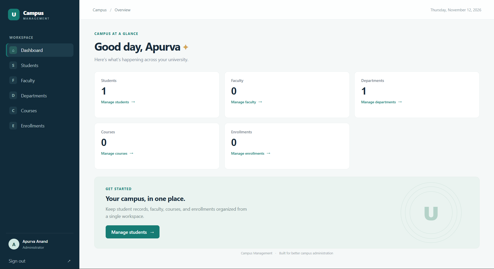
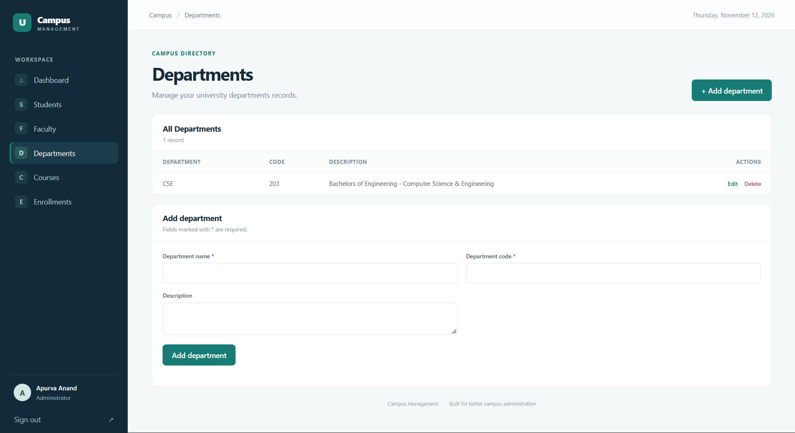
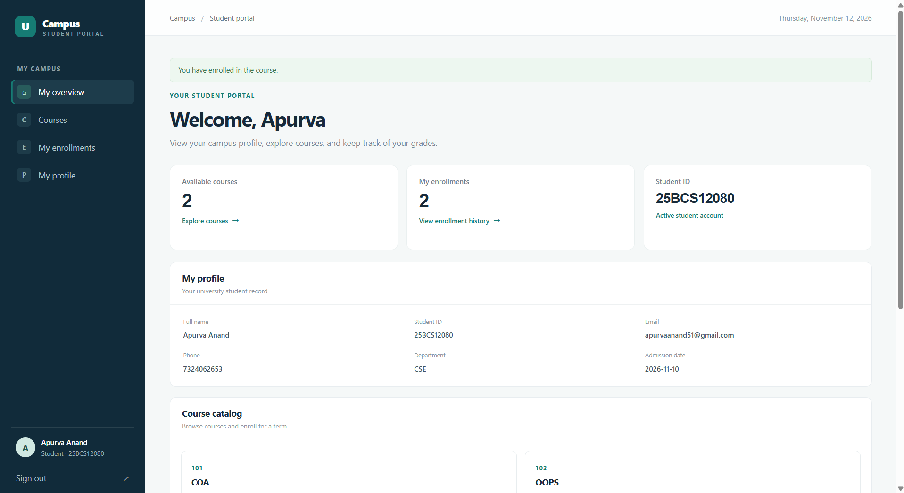
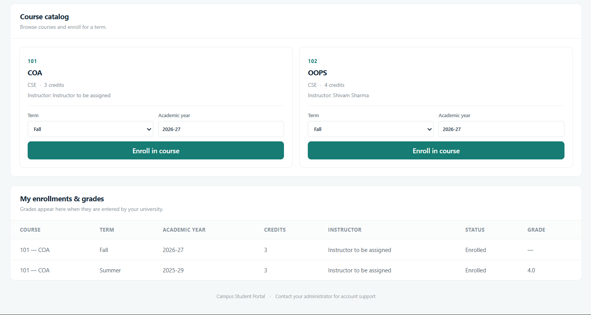

# Campus University Management System

A PHP and MySQL application for managing students, faculty, departments, courses, and enrollments. It includes a separate administrator workspace and student portal.

## Team Members

| Name | UID |
|---|---|
| Apurva Anand | 25BCS12080 |
| Tabish Khan | 25BCS12094 |

## Screenshots

### Administrator sign in

<p align="center">
  
</p>

### Administrator dashboard

<p align="center">
  
</p>

### Department management

<p align="center">
  
</p>

### Student portal

<p align="center">
  
</p>

### Course catalog and grades

<p align="center">
  
</p>

## Choose how to run it

- **One computer:** Run PHP and MySQL on the same computer. Open the site at `http://localhost:8000`.
- **Several computers using the same records:** Host the PHP application and MySQL database on a server that is reachable by all users. Do not expose PHP's built-in development server to the internet.
- **A different computer for each user:** Copying the project creates a separate local database on each computer; it does not share student records.

## Requirements

- PHP 8.0 or later, with `PDO` and `pdo_mysql` enabled
- MySQL 8.0 or later, running locally or on an accessible database host
- The project files on the computer that runs PHP
- MySQL Workbench or phpMyAdmin is optional; the command line can also import the database

## First-time setup on Windows

These steps use PowerShell and assume the project files are in one folder.

### 1. Install and start PHP and MySQL

Install PHP 8.0+ and MySQL 8.0+, or install a local web-development bundle that includes both. During PHP installation, make sure the **PDO MySQL** extension is available. If you have just installed PHP, close and reopen PowerShell so it picks up the updated PATH.

Check that the commands are available:

```powershell
php -v
php -m | Select-String 'PDO|pdo_mysql'
mysql --version
```

The PHP module list must include both `PDO` and `pdo_mysql`. The MySQL server must be running; having the `mysql` command-line client installed does not start the server.

If MySQL is installed as the Windows service `MySQL80`, start PowerShell as Administrator and run:

```powershell
Start-Service MySQL80
```

Service names vary. Find the installed service with:

```powershell
Get-Service *mysql*
```

Alternatively, start MySQL from your development bundle's control panel.

### 2. Open PowerShell in the project folder

In File Explorer, open the folder containing `database.sql` and `config.php`, click the address bar, type `powershell`, and press Enter. Confirm that the folder contains the expected files:

```powershell
Get-ChildItem
```

You should see `database.sql`, `config.php`, `index.php`, and `student_login.php`.

### 3. Create and import the database (new database only)

The supplied `database.sql` creates the `university_management` database and its tables. Import it once for a new installation using a MySQL account that is allowed to create databases.

**Option A — MySQL Workbench**

1. Connect to your MySQL server.
2. Select **File → Open SQL Script** and open `database.sql` from the project folder.
3. Execute the script using the lightning-bolt button.
4. Refresh the schemas list and check for `university_management`.

**Option B — MySQL command line**

If `mysql` is on PATH, run this from PowerShell in the project folder:

```powershell
mysql --user=root --password --execute (Get-Content -Raw .\database.sql)
```

Enter the MySQL password when prompted. If `mysql` is not on PATH, use its full path instead:

```powershell
$mysql = 'C:\Program Files\MySQL\MySQL Server 8.0\bin\mysql.exe'
& $mysql --user=root --password --execute (Get-Content -Raw .\database.sql)
```

Replace the executable path if MySQL is installed elsewhere.

**Option C — phpMyAdmin**

1. Open phpMyAdmin and sign in to MySQL.
2. Choose **Import** and select `database.sql`.
3. Start the import and confirm the `university_management` database and tables were created.

**Existing or hosted database:** Do not use the import commands above blindly on a database with existing records. This script uses `CREATE TABLE IF NOT EXISTS`, which does not update existing tables. For an existing installation, see [Updating an existing database](#updating-an-existing-database). On hosting where the database was already created for you, select that database in phpMyAdmin and import only the table definitions; remove the `CREATE DATABASE` and `USE university_management` statements first if your provider requires it.

### 4. Set the database connection

Open `config.php` in an editor. Set `DB_HOST`, `DB_PORT`, `DB_NAME`, `DB_USER`, and `DB_PASSWORD` to the values for your MySQL server. For a database running on the same computer, the defaults are usually `127.0.0.1` and `3306`; use the database name, user, and password you created or were assigned.

Save the file before starting PHP. **Never share or publish a `config.php` containing a real password.** Use a dedicated MySQL account with access limited to this application's database; avoid using the MySQL `root` account for a public deployment.

### 5. Fix `could not find driver` if necessary

This error means PHP cannot load its MySQL PDO extension. Check which PHP configuration file is loaded:

```powershell
php --ini
```

If `php --ini` lists a `php.ini` file, open that file. If it says `Loaded Configuration File: (none)`, create one from PHP's development template:

```powershell
$phpDir = Split-Path (Get-Command php).Source
Copy-Item "$phpDir\php.ini-development" "$phpDir\php.ini"
```

In the `php.ini` file, enable the PDO MySQL extension (for example, `extension=pdo_mysql`) and ensure `extension_dir` points to the PHP installation's `ext` folder. Save the file, restart the terminal and PHP server, and check again:

```powershell
php -m | Select-String 'PDO|pdo_mysql'
```

If you use the Windows ZIP/WinGet PHP installation and have not created a `php.ini`, you can test or run the server with the extension explicitly enabled:

```powershell
$phpDir = Split-Path (Get-Command php).Source
php -d "extension_dir=$phpDir\ext" -d extension=php_pdo_mysql.dll -m | Select-String pdo_mysql
php -d "extension_dir=$phpDir\ext" -d extension=php_pdo_mysql.dll -S localhost:8000
```

Keep the second command as the running server. These `-d` settings apply only to that PHP process; use the `php.ini` instructions above for persistent configuration.

If using a bundle such as XAMPP, enable `pdo_mysql` in the PHP configuration **used by that bundle** and start the server from its control panel, or run its own PHP executable instead of a different PHP installation on PATH.

### 6. Start the website

In the project folder, run:

```powershell
php -S localhost:8000
```

If you used the explicit `pdo_mysql` command in step 5, that command has already started the server. Keep the PowerShell window open while you use the application. Press **Ctrl+C** in that window to stop the server.

### 7. Create the administrator and open the portals

On a new database with no administrator accounts, open `http://localhost:8000/setup.php` and create the first administrator. Then use:

- Administrator sign-in: `http://localhost:8000/login.php`
- Student sign-in: `http://localhost:8000/student_login.php`

The administrator adds student records in the **Students** area and sets a temporary password of at least 10 characters. Give the student ID and temporary password to the student through a secure, separate channel. Students must choose a new password the first time they sign in.

Add a department before creating faculty or courses. Add a student and a course before enrolling a student. Students can browse courses, enroll for a term, and view their own enrollment status and grades.

## Setup on macOS or Linux

1. Install PHP 8.0+, the PHP MySQL/PDO driver, and MySQL 8.0+. For example, on Debian/Ubuntu:

   ```sh
   sudo apt install php php-mysql mysql-server
   ```

   On macOS with Homebrew:

   ```sh
   brew install php mysql
   ```

   Start the MySQL server using your operating system or package manager's service controls.

2. In a terminal, change to the project directory:

   ```sh
   cd /path/to/project
   ```

3. Confirm PHP has the MySQL driver:

   ```sh
   php -m | grep -E 'PDO|pdo_mysql'
   ```

   If `pdo_mysql` is missing, install/enable the PHP MySQL driver for your PHP version and restart PHP.

4. Import the database once on a new installation:

   ```sh
   mysql -u root -p < database.sql
   ```

5. Set the database connection values in `config.php`, then start the development server:

   ```sh
   php -S localhost:8000
   ```

6. Open `http://localhost:8000/setup.php` to create the first administrator, then use the portal addresses listed above.

## Updating an existing database

Back up the database before applying schema changes. An existing database created before student login was added needs this migration once, run from the project folder:

```powershell
php .\migrations\001_student_login.php
```

On macOS or Linux:

```sh
php migrations/001_student_login.php
```

The migration is safe to run again. It uses the database settings in `config.php` and must be run with a PHP CLI that has `pdo_mysql` enabled. Existing student records do not automatically get login access; an administrator must set a temporary password for each student who needs an account.

## Using the application from other computers

`localhost` only works on the computer running the application. To share the same records across computers, deploy the PHP app and MySQL database to an online PHP/MySQL host or a properly secured server, then configure the app to connect to that database. Use HTTPS, protect database credentials, create a restricted MySQL user, and restrict or remove public access to `setup.php` after creating the administrator.

PHP's built-in server (`php -S`) is for local development. Do not expose it directly to the internet or use it as a production web server. A public deployment needs a properly configured production web server and database host.

## Troubleshooting

| Message or symptom | What to check |
|---|---|
| `could not find driver` | Enable `pdo_mysql` for the same PHP executable that runs the web server. Follow step 5, then restart PHP. |
| `Access denied for user` | Check `DB_USER`, `DB_PASSWORD`, `DB_HOST`, and the MySQL permissions granted to that user. Do not post passwords in chat or commit them to a repository. |
| `Unknown database 'university_management'` | Import `database.sql` on the MySQL server configured in `config.php`. |
| MySQL connection refused | Make sure the MySQL **server** is running and `DB_HOST`/`DB_PORT` point to the correct server. |
| `php` or `mysql` is not recognized | Install it or add its installation folder to PATH, then open a new PowerShell or terminal window. |
| Port 8000 is already in use | Start the development server on another port, for example `php -S localhost:8001`, and open `http://localhost:8001`. |
| Student cannot sign in | In the admin workspace, verify the student record and set a temporary password. The student logs in using their student ID, not their email address. |

## Features

- Administrator sign-in with hashed passwords and session-based access control
- Student sign-in with administrator-provisioned accounts and a required first-login password change
- Student profiles, course catalog, course enrollment, enrollment status, and grades
- Create, edit, list, and delete records for students, faculty, departments, courses, and enrollments
- Validated forms, CSRF tokens, prepared statements, relational foreign keys, and responsive layouts
